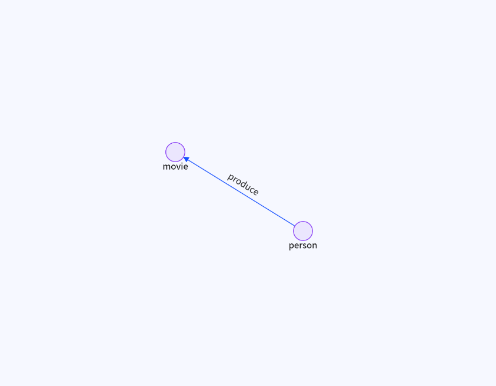
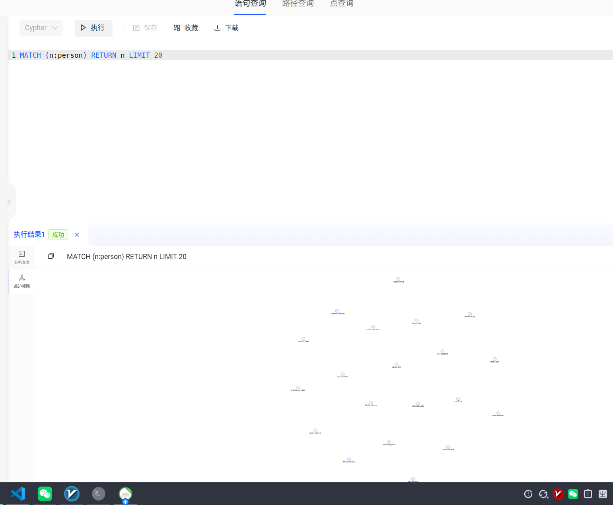
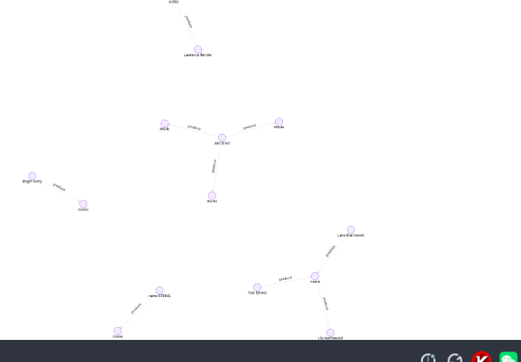

# TuGraph 图数据库作业报告

## 一、环境与数据

- **TuGraph 版本**：社区版 V4.5.2
- **部署方式**：Docker 容器
- **镜像**：`tugraph/tugraph-runtime-centos7:latest`
- **端口映射**：7070（Web）、7687（Bolt）、9090（RPC）

### 图模型

| 类型 | 名称 | 说明 |
|---|---|---|
| 点 | person | 人员，主键 id |
| 点 | movie | 电影，主键 id |
| 边 | produce | person → movie，表示制作关系 |



### 数据规模

- person 节点：约 670 个
- movie 节点：55 个
- produce 边：若干

---

## 二、基础查询

### 1. 查询所有节点

```cypher
MATCH (n) RETURN n LIMIT 20
```


结果：返回 person 和 movie 节点样本，包含 name、born、poster_image 等属性。

### 2. 按标签查询 person

```cypher
MATCH (n:person) RETURN n LIMIT 20
```



结果：返回 person 节点列表。

### 3. 按标签和属性查询

```cypher
MATCH (n:person {name: 'Lana Wachowski'}) RETURN n
```


结果：返回 Lana Wachowski 节点，id=14。

### 4. 匹配任意关系路径

```cypher
MATCH p = (n)-[r]->(m) RETURN p LIMIT 10
```



结果：返回 10 条路径，可视化显示 person → produce → movie。

### 5. 过滤匹配：查 Lana Wachowski 制作的电影

```cypher
MATCH (n:person)-[r:produce]->(m:movie)
WHERE n.name = 'Lana Wachowski'
RETURN m.title
```

结果：

```
Cloud Atlas
```

### 6. 前缀匹配：查标题以 "The" 开头的电影

```cypher
MATCH (n:movie) WHERE n.title STARTS WITH "The" RETURN n.title
```

结果（部分）：

```
The Matrix
The Matrix Reloaded
The Matrix Revolutions
The Shawshank Redemption
The Godfather
The Godfather: Part II
The Good, the Bad and the Ugly
The Dark Knight
The Dark Knight Rises
The Lord of the Rings: The Return of the King
```

---

## 三、复杂查询

### 1. 按节点属性分组计数：统计每个出生年份的人数

```cypher
MATCH (p:person) RETURN p.born, COUNT(*) AS count ORDER BY count DESC
```

结果（部分）：

| p.born | count |
|---|---|
| 1000 | 62 |
| 1967 | 24 |
| 1965 | 17 |
| 1959 | 17 |
| 1970 | 16 |
| 1976 | 15 |
| 1971 | 15 |
| 1964 | 15 |
| 1969 | 15 |
| 1957 | 14 |

### 2. 使用 WITH 多阶段聚合过滤：查制作电影数 > 2 的人

```cypher
MATCH (p:person)-[r:produce]->(m:movie)
WITH p, COUNT(m) AS movieCount
WHERE movieCount > 2
RETURN p.name, movieCount ORDER BY movieCount DESC
```

结果：

| p.name | movieCount |
|---|---|
| Harvey Weinstein | 4 |
| Bob Weinstein | 4 |
| Peter Jackson | 3 |
| Christopher Nolan | 3 |
| Joel Silver | 3 |

### 3. 去重计数：统计每部电影有多少不同的制作人

```cypher
MATCH (p:person)-[r:produce]->(m:movie)
RETURN m.title, COUNT(DISTINCT p) AS uniqueProducers
ORDER BY uniqueProducers DESC
```

结果（部分）：

| m.title | uniqueProducers |
|---|---|
| Hansel & Gretel: Witch Hunters | 3 |
| The Lord of the Rings: The Fellowship of the Ring | 3 |
| Cloud Atlas | 3 |
| The King's Speech | 3 |
| The Avengers | 3 |
| The Lord of the Rings: The Two Towers | 3 |
| The Lord of the Rings: The Return of the King | 3 |
| 12 Years a Slave | 2 |
| Hugo | 2 |
| Gravity | 2 |

### 4. 聚合：统计电影总数

```cypher
MATCH (n:movie) RETURN COUNT(n) AS total
```

结果：

```
total: 55
```

### 5. 排序限制：按 id 降序查前 10 个人

```cypher
MATCH (n:person) RETURN n ORDER BY n.id DESC LIMIT 10
```

结果：返回 id 最大的 10 个 person 节点，如 Giovanni Ribisi（id=3917）、Anna Faris（id=3916）等。

---

## 四、创建与删除

### 1. 创建 person 节点：James Wan

```cypher
CREATE (n:person {name: 'James Wan', id: 10000, born: '1977'})
```

结果：`created 1 vertices, created 0 edges.`

验证：

```cypher
MATCH (n:person {name: 'James Wan'}) RETURN n
```

返回 James Wan 节点，id=10000，born='1977'。

> 注意：`born` 字段类型为 STRING，必须写 `'1977'` 而不是 `1977`。

### 2. 创建 movie 节点：Fast & Furious 7

```cypher
CREATE (n:movie {title: 'Fast & Furious 7', id: 10001, tagline: "assada"})
```

结果：`created 1 vertices, created 0 edges.`

### 3. 创建关系：James Wan 制作 Fast & Furious 7

```cypher
MATCH (n:person), (m:movie)
WHERE n.name = 'James Wan' AND m.title = 'Fast & Furious 7'
CREATE (n)-[r:produce]->(m)
RETURN r
```

结果：创建一条 produce 边，start=721，end=722。

### 4. 更新数据：给 James Wan 添加照片

```cypher
MATCH (n:person {name: 'James Wan'})
SET n.poster_image = 'this is an image'
RETURN n
```

结果：poster_image 被设为 `'this is an image'`。

### 5. 删除属性：REMOVE 删除照片

```cypher
MATCH (n:person {name: 'James Wan'})
REMOVE n.poster_image
RETURN n
```

结果：poster_image 恢复为 null。

### 6. 删除边

```cypher
MATCH (n:person {name: 'James Wan'})-[r]-() DELETE r
```

结果：`deleted 0 vertices, deleted 1 edges.`

### 7. 删除 person 节点

```cypher
MATCH (n:person {name: 'James Wan'}) DELETE n
```

结果：`deleted 1 vertices, deleted 0 edges.`

### 8. 删除 movie 节点

```cypher
MATCH (n:movie {title: 'Fast & Furious 7'}) DELETE n
```

结果：`deleted 1 vertices, deleted 0 edges.`

---

## 五、总结

1. **Cypher 与 SQL 的区别**：Cypher 没有显式 GROUP BY，分组由聚合函数隐式触发。
2. **WITH 的作用**：用于多阶段查询，把上一阶段结果传递给下一阶段，并可在此过滤。
3. **DELETE 与 REMOVE 的区别**：
   - `DELETE` 用于删除节点和关系。
   - `REMOVE` 用于删除节点的标签与属性。
4. **删除有边的节点**：必须先删除相关边，再删除节点。
5. **类型注意**：`born` 是 STRING，`id` 是 INT32，创建时类型必须匹配。

---

## 六、附录：常用命令速查

```cypher
MATCH (n) RETURN n LIMIT 20
MATCH (n:person) RETURN n LIMIT 20
MATCH (n:person {name: 'Lana Wachowski'}) RETURN n
MATCH p = (n)-[r]->(m) RETURN p LIMIT 10
MATCH (n:person)-[r:produce]->(m:movie) WHERE n.name = 'Lana Wachowski' RETURN m.title
MATCH (n:movie) WHERE n.title STARTS WITH "The" RETURN n.title
MATCH (p:person) RETURN p.born, COUNT(*) AS count ORDER BY count DESC
MATCH (p:person)-[r:produce]->(m:movie) WITH p, COUNT(m) AS movieCount WHERE movieCount > 2 RETURN p.name, movieCount ORDER BY movieCount DESC
MATCH (p:person)-[r:produce]->(m:movie) RETURN m.title, COUNT(DISTINCT p) AS uniqueProducers ORDER BY uniqueProducers DESC
MATCH (n:movie) RETURN COUNT(n) AS total
MATCH (n:person) RETURN n ORDER BY n.id DESC LIMIT 10
CREATE (n:person {name: 'James Wan', id: 10000, born: '1977'})
CREATE (n:movie {title: 'Fast & Furious 7', id: 10001, tagline: "assada"})
MATCH (n:person), (m:movie) WHERE n.name = 'James Wan' AND m.title = 'Fast & Furious 7' CREATE (n)-[r:produce]->(m) RETURN r
MATCH (n:person {name: 'James Wan'}) SET n.poster_image = 'this is an image' RETURN n
MATCH (n:person {name: 'James Wan'}) REMOVE n.poster_image RETURN n
MATCH (n:person {name: 'James Wan'})-[r]-() DELETE r
MATCH (n:person {name: 'James Wan'}) DELETE n
MATCH (n:movie {title: 'Fast & Furious 7'}) DELETE n
```
