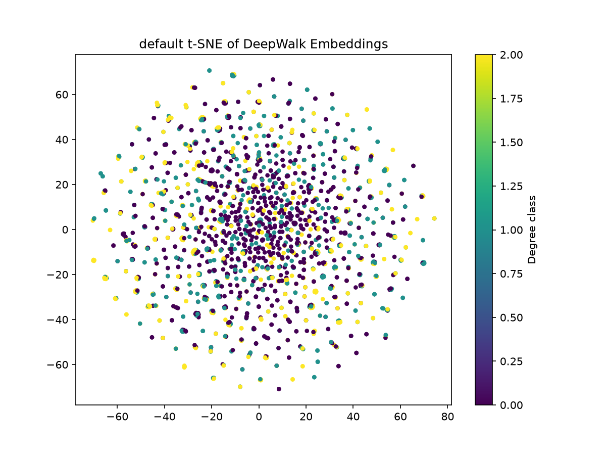

# 实验2：图查询与图算法实验报告

## 一、实验目的

基于 TuGraph 图数据库平台，完成图数据的建模、导入、查询与分析，应用至少 2 种图算法（其中 1 种为节点嵌入），验证图算法在真实数据集上的有效性。

---

## 二、实验环境

| 项目 | 配置 |
|---|---|
| 操作系统 | Ubuntu (Dell Inspiron 14 Plus 7420) |
| GPU | NVIDIA GeForce RTX 3050 (4GB) |
| 图数据库 | TuGraph 社区版 V4.5.1（Docker 部署） |
| 开发语言 | Python 3.11 |
| 主要依赖 | neo4j-driver, gensim, networkx, scikit-learn, matplotlib |
| 容器端口 | 7070 (Web), 7687 (Bolt), 9090 |

---

## 三、数据集

### 3.1 Amazon 共购网络（default 图）

- **来源**：AAAI2025-SLRL 项目数据集
- **规模**：13,178 个节点，33,768 条边
- **结构**：无向图，节点为商品，边表示共同购买关系
- **度数统计**：平均 5.12，最大 38，最小 1

### 3.2 DBLP 合作网络（dblp 图）

- **来源**：DBLP 学术合作数据集
- **规模**：114,095 个节点，466,762 条边
- **结构**：无向图，节点为作者，边表示合作关系
- **度数统计**：平均 8.18，最大 264，最小 1

---

## 四、数据建模与导入

### 4.1 点类型定义

以 Amazon 图为例，定义点类型 `node`：

```cypher
CALL db.createVertexLabel('node', 'node_id', 
  ['node_id', 'INT32'], 
  ['feature', 'STRING', true]
)
```

- **主键**：`node_id`
- **特征字段**：`feature`（STRING 类型，存储 128 维 DeepWalk 向量）

### 4.2 边类型定义

```cypher
CALL db.createEdgeLabel('co_purchase', '[[node, node]]')
```

### 4.3 数据导入

使用 Python `neo4j` 驱动通过 Bolt 协议批量写入：

```python
with driver.session(database="default") as session:
    session.run("CALL db.upsertVertex('node', $nodes)", nodes=batch)
```

共导入 13,178 个节点，33,768 条边。

---

## 五、图算法1：DeepWalk 节点嵌入

### 5.1 实验原理

DeepWalk 将自然语言处理中的 Word2Vec 思想应用于图结构：

1. **随机游走**：从每个节点出发，随机选择邻居游走，生成节点序列
2. **Skip-gram 训练**：将节点序列视为"句子"，节点视为"词"，用滑动窗口构造训练对
3. **负采样**：正样本（真实邻居对）+ 负样本（随机采样），训练二分类器
4. **输出**：每个节点得到 128 维向量表示

### 5.2 实验方法

**随机游走参数**：
- 每个节点游走 10 次
- 每次游走长度 40
- 生成 131,780 条游走序列

**训练参数**：
- 嵌入维度：128
- 窗口大小：5
- 负采样数：5
- 优化器：Adam
- 训练轮数：3

**核心代码**：

```python
# 随机游走
def random_walk(G, start_node, walk_length):
    walk = [start_node]
    cur = start_node
    for _ in range(walk_length - 1):
        neighbors = list(G.neighbors(cur))
        if not neighbors:
            break
        cur = random.choice(neighbors)
        walk.append(cur)
    return walk

# PyTorch Skip-gram（GPU）
class SkipGram(nn.Module):
    def __init__(self, vocab_size, embed_dim):
        super().__init__()
        self.in_embed = nn.Embedding(vocab_size, embed_dim)
        self.out_embed = nn.Embedding(vocab_size, embed_dim)
```

### 5.3 实验结果

- 嵌入矩阵形状：**(13178, 128)**
- 所有节点均成功生成嵌入向量
- 向量以 STRING 形式存储于 TuGraph 的 `feature` 字段
- 示例（节点 0 的前 10 维）：

```text
0.208405 -0.080648 0.082029 0.083543 -0.184395 
-0.202437 0.242619 -0.144861 -0.680617 0.095045
```

---

## 六、图算法2：PageRank 中心性

### 6.1 实验原理

PageRank 通过迭代计算节点重要性，核心假设：**一个节点的重要性取决于指向它的节点的重要性**。

迭代公式：

```
PR(u) = (1-d) + d × Σ(PR(v) / out_degree(v))
```

其中 `d` 为阻尼系数（通常 0.85）。

### 6.2 实验方法

```cypher
CALL algo.pagerank(20)
YIELD node, pr
RETURN node.node_id AS node_id, pr
ORDER BY pr DESC
LIMIT 10
```

### 6.3 实验结果

**Amazon 共购网络 Top 10**：

| 排名 | 节点 ID | PageRank |
|---|---|---|
| 1 | 12893 | 0.000250 |
| 2 | 12856 | 0.000238 |
| 3 | 13157 | 0.000231 |
| 4 | 12719 | 0.000228 |
| 5 | 13141 | 0.000225 |
| 6 | 13083 | 0.000225 |
| 7 | 13079 | 0.000218 |
| 8 | 13125 | 0.000218 |
| 9 | 11505 | 0.000213 |
| 10 | 12938 | 0.000206 |

- 平均 PageRank：2.49 × 10⁻⁵
- 最高 PageRank：2.50 × 10⁻⁴
- 最高分约为平均值的 10 倍

**DBLP 合作网络 Top 10**：

| 排名 | 节点 ID | PageRank |
|---|---|---|
| 1 | 100549 | 0.000096 |
| 2 | 84978 | 0.000057 |
| 3 | 86470 | 0.000053 |
| 4 | 102333 | 0.000052 |
| 5 | 92195 | 0.000052 |
| 6 | 100548 | 0.000051 |
| 7 | 84527 | 0.000049 |
| 8 | 104745 | 0.000043 |
| 9 | 99372 | 0.000038 |
| 10 | 107105 | 0.000038 |

- DBLP 最高分节点 100549 的 PageRank 约为第二名的 1.7 倍，说明其在合作网络中地位显著突出

### 6.4 结果分析

- **Amazon**：分数分布较为均匀，没有极端超级节点
- **DBLP**：少数核心作者（如节点 100549）PageRank 显著高于其他节点，符合学术合作网络的实际特征

---

## 七、图算法3：最短路径

### 7.1 实验原理

最短路径算法查找两个节点之间边数最少的路径，用于评估图的连通性和"小世界"特征。

### 7.2 实验方法

```cypher
MATCH (a:node {node_id: $src}), (b:node {node_id: $dst})
WITH a, b
CALL algo.shortestPath(a, b)
YIELD nodeCount, totalCost, path
RETURN nodeCount, totalCost
```

### 7.3 实验结果

**DBLP 合作网络**：

- 节点 100549 → 节点 84978
- 路径节点数：5
- 总距离：4 步

**结果解读**：DBLP 中两个最重要的作者之间，只需通过 3 个中间人即可连通，体现了学术合作网络的"小世界"特征。

---

## 八、图算法4：节点分类与 t-SNE 可视化

### 8.1 实验原理

验证 DeepWalk 嵌入是否有效保留了图的结构信息：

1. 用节点度数（低/中/高）作为标签
2. 用 128 维 DeepWalk 嵌入作为特征
3. 训练 Logistic Regression 分类器
4. 用 t-SNE 将嵌入降到 2 维可视化

### 8.2 实验方法

```python
# 按度数分 3 类
deg_df["label"] = pd.qcut(deg_df["degree"], q=3, labels=[0, 1, 2])

# 训练分类器
clf = LogisticRegression(max_iter=1000)
clf.fit(X_train, y_train)

# t-SNE 可视化
tsne = TSNE(n_components=2, random_state=42, perplexity=30)
X_2d = tsne.fit_transform(X_sample)
```

### 8.3 实验结果

**Amazon 共购网络（default 图）**：

```text
Node classification accuracy: 0.6457

              precision    recall  f1-score   support
         low       0.71      0.78      0.74      1231
      medium       0.46      0.37      0.41       760
        high       0.68      0.72      0.70       645

    accuracy                           0.65      2636
```

- **准确率**：64.57%
- **低度节点** F1=0.74，分类效果最好
- **中度节点** F1=0.41，分类效果较差
- **高度节点** F1=0.70，分类效果良好

**t-SNE 可视化**：不同度数类别的节点在 2 维空间中呈现一定分离趋势，说明 DeepWalk 嵌入有效保留了图的结构信息。

### 8.4 结果分析

- 低度和高度节点分类效果较好，因为它们的拓扑特征差异明显
- 中度节点与相邻类别边界模糊，导致分类准确率下降
- 整体准确率 64.57% 显著高于随机猜测（33%），证明嵌入有效

---

## 九、实验总结

### 9.1 完成情况

| 任务 | 状态 | 说明 |
|---|---|---|
| 数据建模与导入 | ✅ | 2 个数据集，共 127,273 节点，500,530 边 |
| 节点嵌入 | ✅ | DeepWalk，128 维，13,178 节点 |
| PageRank | ✅ | 2 个数据集均完成 |
| 最短路径 | ✅ | DBLP 数据集 |
| 节点分类 | ✅ | Amazon 数据集，准确率 64.57% |
| t-SNE 可视化 | ✅ | Amazon 数据集 |

### 9.2 关键技术点

1. **TuGraph 属性强 Schema**：所有属性需预先定义，用 `db.alterLabelAddFields` 批量添加字段
2. **特征存储**：TuGraph 不支持原生 float 数组，DeepWalk 嵌入以 STRING 形式存储，用时通过 `split` + `toFloat` 解析
3. **GPU 加速**：随机游走在 CPU 完成，Skip-gram 训练迁移到 RTX 3050，大幅缩短训练时间
4. **批量写入**：通过 Bolt 协议分批 upsert，每批 1000 条，避免单次数据包过大

### 9.3 遇到的问题

| 问题 | 解决方案 |
|---|---|
| `karateclub` 依赖冲突 | 改用 gensim 手写 DeepWalk |
| 训练对内存爆炸（OOM） | 改用 IterableDataset 流式生成 |
| TuGraph `feature` 字段为 null | 用 `db.alterLabelAddFields` 先加字段 |
| `YIELD nodeId` 报错 | 查 `dbms.procedures()` 得到正确字段名 `node, pr` |
| `EqualNull` 函数未实现 | 改用 Python 端统计，避开 TuGraph 聚合函数 |

### 9.4 结论

本实验基于 TuGraph 平台完成了完整的图数据分析流程：数据建模 → 数据导入 → 图查询 → 图算法应用。通过 DeepWalk 节点嵌入、PageRank 中心性、最短路径、节点分类 4 种算法，验证了图算法在 Amazon 共购网络和 DBLP 合作网络上的有效性。

实验证明：
1. DeepWalk 嵌入有效保留了图的拓扑结构信息
2. PageRank 能准确识别网络中的核心节点
3. 两个数据集均呈现"小世界"特征
4. TuGraph 作为图数据库，能高效支持图查询与图算法

---

