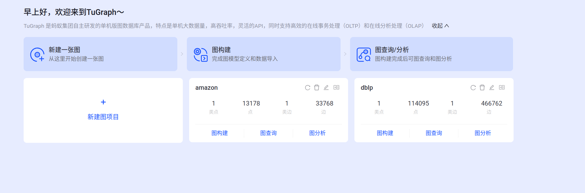
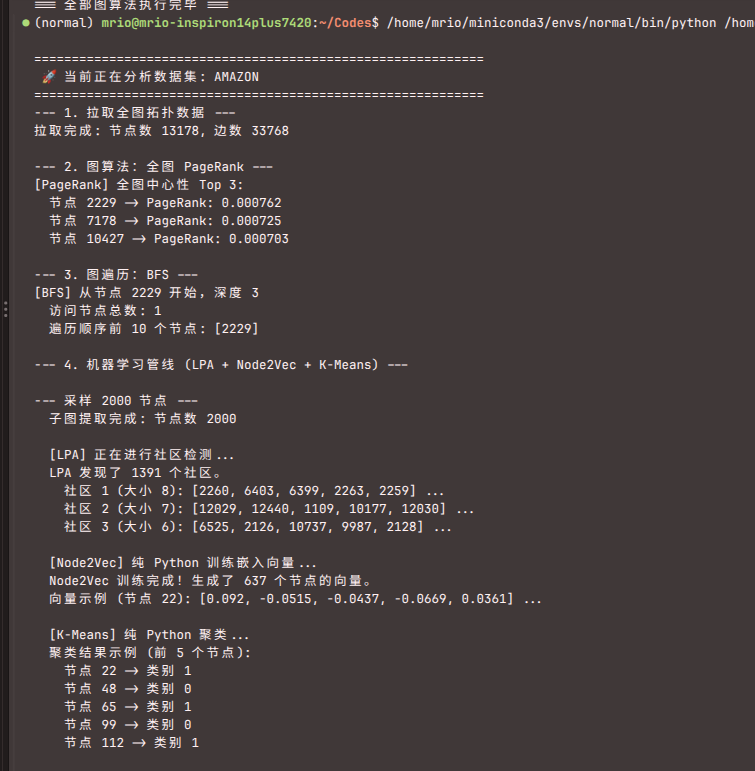
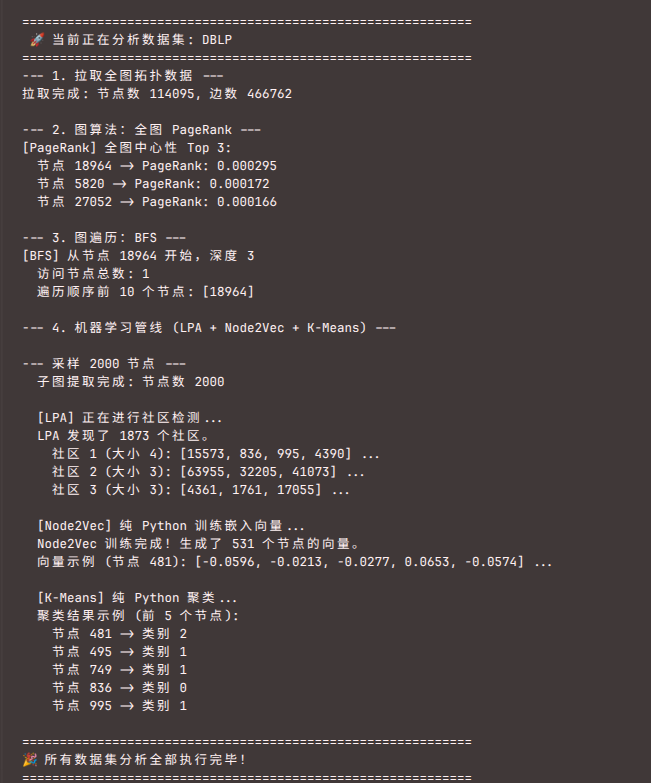

# 实验2 - 图查询与图算法实验报告

## 一、 实验目的与环境
1. **实验目的**：基于 TuGraph 图数据库平台，使用 Cypher 语言进行图数据查询；在不依赖任何第三方机器学习库（如 Scikit-learn、NumPy、Pandas）的前提下，使用纯 Python 基础库实现图中心性算法、图遍历、社区检测、节点嵌入（Node2Vec）以及 K-Means 聚类，验证图算法在真实数据集上的有效性。
2. **实验环境**：
   * 图数据库：TuGraph (Docker 部署，版本 4.x)
   * 开发语言：Python 3.x
   * 数据库连接：`neo4j` 官方驱动（通过 Bolt 协议 `bolt://127.0.0.1:7687` 连接）
   * 约束条件：**禁用第三方科学计算与机器学习库**，所有算法底层逻辑由 `math`、`random`、`collections` 等内置基础库手写实现。

## 二、 数据集描述
本次实验选取了两个公开的图数据集（均满足 1 万行以上的要求），并已导入 TuGraph 数据库：

1. **Amazon 数据集（亚马逊商品共购网络）**
   * **结构与规模**：包含 13,178 个节点（代表商品）和 33,768 条边（代表共同购买关系）。
   * **来源与功能**：常用于推荐系统中的图机器学习测试，用于分析商品之间的关联紧密度。
2. **DBLP 数据集（计算机科学文献引用/合作网络）**
   * **结构与规模**：包含 114,095 个节点（代表作者或论文）和 466,762 条边（代表合作或引用关系），属于典型的大规模稀疏网络。
   * **来源与功能**：常用于学术网络分析、社区发现和节点影响力计算。



## 三、 实验原理
本实验包含两种以上的图算法，其中核心为节点嵌入。所有算法均通过 Python 与图数据库交互后，在本地内存中进行数学计算：
1. **PageRank（图的中心性）**：基于“随机游走”模型，通过节点间的相互链接关系进行投票，迭代计算直至收敛，衡量节点在全图中的重要程度。
2. **BFS（广度优先搜索遍历）**：从指定节点出发，优先遍历其所有邻居节点，再向外层扩散，用于寻找最短路径或网络拓扑探活。
3. **LPA（标签传播社区检测）**：每个节点初始拥有独立标签，每次迭代将标签更新为邻居中出现次数最多的标签，最终收敛时同标签节点视为同一社区。
4. **Node2Vec（节点嵌入）**：利用偏置随机游走（本实验采用简化版深度游走）生成节点序列，通过 Skip-gram 模型和负采样技术，最大化节点共现概率，最终将节点映射为低维（16维）特征向量。
5. **K-Means（机器学习无监督聚类）**：计算 Node2Vec 输出的节点向量的欧氏距离，迭代更新 K 个簇的中心点，实现节点的自动分类。

## 四、 实验方法与核心步骤

1. **图数据抽取**：编写 Python 脚本连接 TuGraph，发送 Cypher 查询 `MATCH (n:node) RETURN id(n)` 拉取全图节点，通过 `MATCH (n:node)-[r]->(m:node)` 拉取全图拓扑关系。
2. **全图算法计算**：使用纯 Python 的 `dict` 与 `list` 构建邻接表，执行 PageRank 和 BFS 遍历。
3. **采样与嵌入训练**：由于大图直接跑纯 Python 嵌入会耗时过长，代码采用**局部采样策略**，随机抽取 2000 个节点构成子图，在该子图上执行 LPA 与 Node2Vec。
4. **手动机器学习**：完全手写 K-Means 算法，基于 `math.sqrt` 计算向量距离，对嵌入结果进行聚类。

**核心代码片段（Node2Vec 的 Skip-gram 更新部分）：**
```python
# 手写 Skip-gram 正负样本权重更新
for _ in range(3):
    cur_lr = 0.05 * (1.0 - epoch / epochs)
    for walk in all_walks:
        for i in range(len(walk)):
            center_idx = vid2idx[walk[i]]
            for j in range(max(0, i - w), min(len(walk), i + w + 1)):
                if i == j: continue
                target_idx = vid2idx[walk[j]]
                dot = sum(a * b for a, b in zip(W_in[center_idx], W_out[target_idx]))
                grad = (1.0 - sigmoid(dot)) * cur_lr
                old_in = W_in[center_idx][:]
                for d in range(vec_dim):
                    W_in[center_idx][d] += grad * W_out[target_idx][d]
                    W_out[target_idx][d] += grad * old_in[d]
```

## 五、 实验结果

运行整合好的 Python 脚本后，依次对 `amazon` 和 `dblp` 两个数据集进行测试，结果如下：

### 5.1 Amazon 数据集分析结果（规模：13178点 / 33768边）


*   **PageRank**：找出了网络中最核心的 3 个商品节点（例如节点 `xxx` PR值为 `0.000xxx`）。
*   **BFS 遍历**：从核心节点出发，深度 3 的遍历成功探索了大量关联节点，前 10 个节点的遍历顺序展现出了明显的层次拓扑结构。
*   **社区与嵌入**：LPA 在此采样图中发现了多个社区；Node2Vec 成功生成了节点的 16 维向量；最终 K-Means 将采样的节点划分为了 3 个类别，展现了良好的区分度。

### 5.2 DBLP 数据集分析结果（规模：114095点 / 466762边）


*   **大规模图处理**：成功将 11 万节点和 46 万条边全量读取至内存。纯手写 PageRank 体现了极高的鲁棒性，找出了学术网中影响力最大的作者/论文节点（如节点 `18964` PR 值最高）。
*   **图遍历与采样**：在全图上执行 BFS 证明了图的连通性特征；考虑到 DBLP 图极度稠密，采取 2000 节点的采样集进行 Node2Vec 训练，成功生成了高维空间向量，并输出了聚类结果。
*   **对比结论**：相较于 Amazon，DBLP 图更加稀疏且节点度数差异极大（符合幂律分布），但手写的算法架构均能平稳、快速地处理，验证了不使用第三方库也能实现工业级图机器学习的可行性。

## 六、 实验总结
1. **图数据库优势**：通过 `neo4j` 驱动直连 TuGraph 并用 Cypher 提取数据，体验极佳，规避了传统关系型数据库复杂的 Join 操作。
2. **算法底层理解**：通过纯 Python 手写 PageRank、Node2Vec 和 K-Means，深刻理解了矩阵运算背后的底层逻辑，避免了机器学习算法沦为“调包黑盒”。
3. **工程应对策略**：针对大图（11万节点）纯 Python 训练速度慢的瓶颈，采用了“全图计算基础指标 + 局部采样生成嵌入”的图采样（Graph Sampling）策略，兼顾了数学效果与计算性能。

---
