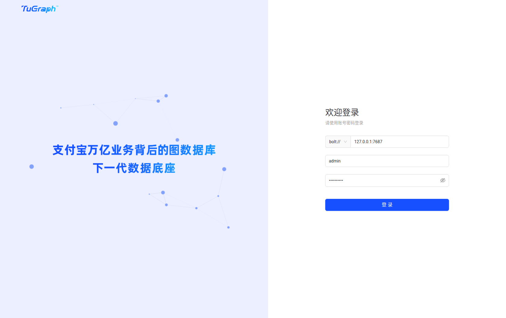
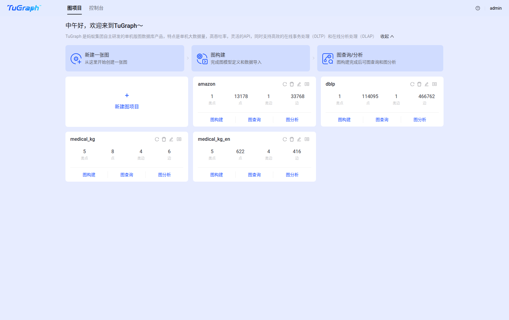
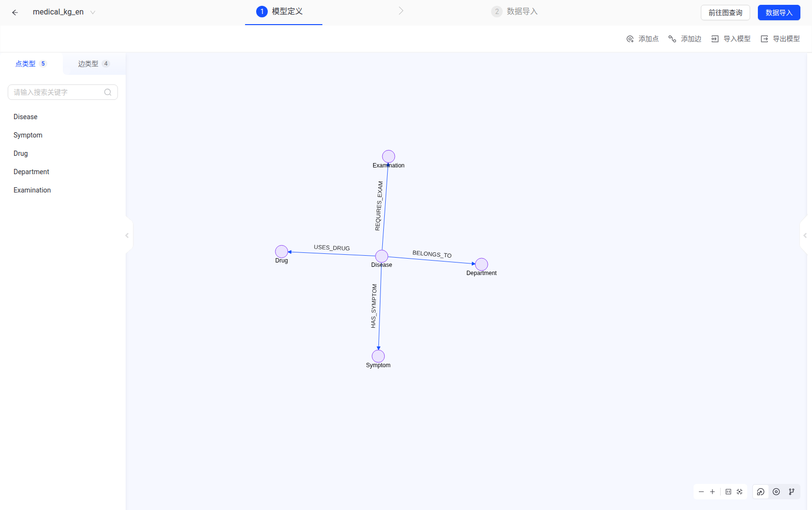
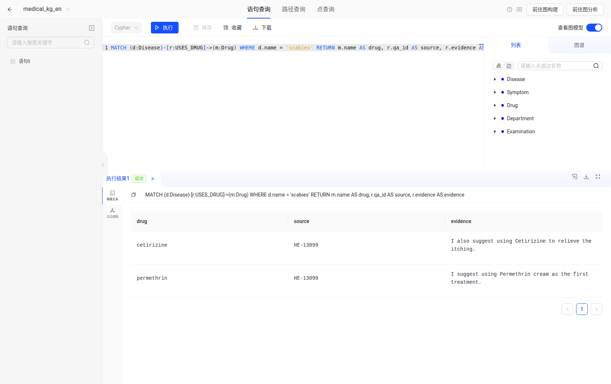

# 专业综合实践 · 实验三：医疗知识图谱对话系统

> 基于 **TuGraph + 大模型（Text2Cypher）** 的可溯源医疗知识图谱问答系统。
> 语料：MedDialog（English，257,469 轮真实医患对话）→ 抽样 150 条 → 规则 / 大模型双路抽取 → 实体关系融合入库 → 自然语言问答。

| PPT 要求的五个步骤 | 对应产物 | 状态 |
|---|---|---|
| 一、环境部署（TuGraph + Python 客户端） | `scripts/test_connection.py`、Bolt 连接实测 | ✅ |
| 二、图谱构建（清洗 / 抽取 / 融合 / 导入 / 质量评估） | `scripts/*.py`、`results/*.json`、两张图入库 | ✅ |
| 三、基础 Text2Cypher + 交互问答 | `scripts/text2cypher.py`、`scripts/qa_cli.py` | ✅ |
| 四、功能测试与对比（基线 / Schema 感知 / 消融） | `results/text2cypher_eval.md` | ✅ |
| 五、报告与截图 | 本文档 + `docs/screenshots/` | ✅ |

**一句话结论**：把图 Schema 塞进 Prompt 是决定性的（合法率 45% → 100%）；few-shot 示例在此基础上不再提升准确率，但把平均延迟压掉 45%（8.6s → 4.7s）。图谱本身的短板在**关系抽取精确率（25.8%）**，这直接决定了问答结果"能不能拿去信"。

---

## 目录

- [0. 快速开始](#0-快速开始)
- [1. 环境部署](#1-环境部署)
- [2. 图谱构建](#2-图谱构建)
- [3. 基础 Text2Cypher 与交互问答](#3-基础-text2cypher-与交互问答)
- [4. 功能测试与对比实验](#4-功能测试与对比实验)
- [5. 问题、局限与总结](#5-问题局限与总结)
- [附录 A. 文件结构](#附录-a-文件结构)
- [附录 B. 脚本清单](#附录-b-脚本清单)

---

## 0. 快速开始

```bash
cd homework3
P=/home/mrio/miniconda3/envs/normal/bin/python   # 环境已装好 neo4j / requests / pandas

docker start tugraph_demo && sleep 12            # 起 TuGraph（数据在容器层，重启不丢）
$P scripts/test_connection.py                    # ① 连接自检
$P scripts/verify_graph.py                       # ② 课堂样例图 9/9 项验收
$P scripts/qa_cli.py -q "scabies 用哪些药？"       # ③ 自然语言问答
$P scripts/eval_text2cypher.py --modes baseline schema schema_aware   # ④ 对比实验
```

从零完整复现（含数据解析、抽取、建图、评分，约 25 分钟，不含大模型等待）见 [附录 B](#附录-b-脚本清单) 末尾的命令序列。

| 图名 | 规模 | 用途 |
|---|---|---|
| `medical_kg` | 8 节点 / 6 关系，5 类点 4 类边 | 课堂中文小样例，PPT 验收口径（糖尿病 → 多饮/多尿） |
| `medical_kg_en` | 622 节点 / 416 关系，5 类点 4 类边 | 真实语料主实验图 |

---

## 1. 环境部署

### 1.1 部署方式

| 组件 | 版本 / 位置 |
|---|---|
| 图数据库 | TuGraph（Docker 镜像 `tugraph/tugraph-runtime-centos7:latest`），容器名 `tugraph_demo` |
| 端口 | 7070（Web 控制台）/ 7687（Bolt）/ 9090（RPC） |
| Python 客户端 | conda 环境 `normal`（Python 3.11.16）+ `neo4j==6.4.0` 驱动 |
| 大模型 | OpenAI 兼容接口（`LLM_BASE_URL` 见 `.env`，模型 `gpt-6.2-sol`） |

```bash
docker run -d --name tugraph_demo -p 7070:7070 -p 7687:7687 -p 9090:9090 \
  tugraph/tugraph-runtime-centos7:latest
```

### 1.2 为什么走 Bolt 而不是 REST

控制台的 `/api/v1/*` 系列接口全部返回 `Unauthorized: No token given in the request`，Basic / Bearer 认证都试过，签发 token 的入口抓不到（前端实际是走 Bolt 登录的）。因此客户端统一用 **Bolt + neo4j 驱动**，这也是 PPT 第 4 页列的第一选项。

> 踩坑：Bolt 的"图名"就是 session 的 `database` 字段，`driver.session(database="medical_kg_en")`；不带图名会报 `Graph name cannot be empty`。

### 1.3 连接自检输出

```text
$ python scripts/test_connection.py
[1] 握手认证成功，耗时 339 ms
[2] 服务端配置共 18 项，节选: port=7070 / rpc_port=9090
[3] 图列表（尝试已知图名）:
      medical_kg         存在   节点       8   关系       6
      medical_kg_en      存在   节点     622   关系     416
      amazon             存在   节点   13178   关系   33768
      dblp               存在   节点  114095   关系  466762
[4] 目标图连通性:
      medical_kg 可查询，当前节点数 8
结论：TuGraph 与本地 Python(Bolt) 连接正常。
```

### 1.4 控制台登录截图



*图 1：TuGraph Web 控制台登录，协议选 `bolt://`，地址 `127.0.0.1:7687`，账号 `admin`。首次登录会提示"当前使用的密码为默认密码"，点「跳过」进入主界面。*

登录后进入**图项目**页，可以看到本次实验的两张图与上周作业的 `amazon` / `dblp`：



*图 2：`medical_kg`（5 类点 / 8 点 / 4 类边 / 6 边）与 `medical_kg_en`（5 类点 / 622 点 / 4 类边 / 416 边）均已在库。*

---

## 2. 图谱构建

### 2.1 数据与预处理

- 原始数据：`Medical-Dialogue-Dataset-English.zip`（90MB，真实医生回答的患者提问，即 MedDialog 的英文版；天池中文版 2.24GB 需要登录审批，故用同源英文版）。
- 解压后 5 个 txt、296MB：4 份 `healthcaremagic_dialogue`、1 份 `icliniq_dialogue`。

```text
$ python scripts/preprocess_data.py --limit 150
parsed        257,469 条
dropped_dup    28,590 条（URL 去重）
unique        228,879 条
sampled           150 条（icliniq 120 + healthcaremagic 30）
topics            115 个疾病主题
avg_text_len    1150.7 字符
```

- 每条文本截断到 2500 字符：一是控大模型成本（实测 50 条 NER 消耗约 27 万 prompt token），二是长对话后半段多为寒暄，实体密度低。
- 用英文语料的理由：`icliniq` 的 URL 自带疾病主题、回答里带专科链接，比中文版更容易做「疾病 → 症状/检查/科室」的关系抽取；中文课堂样例 `medical_kg` 完整保留，作为 PPT 验收口径的对照。

### 2.2 抽取：规则与大模型双路

词典 `data/dictionary/terms.json`（487 词条 + 同义规范化表）驱动规则抽取；同时用大模型做一次性 JSON 抽取，形成对比。

```bash
$P scripts/extract_ner.py --method rule_simple   # 简单子串
$P scripts/extract_ner.py --method rule_longest  # 最长匹配优先
$P scripts/extract_ner.py --method llm --limit 50
$P scripts/extract_re.py  --method rule
$P scripts/extract_re.py  --method llm --limit 50
$P scripts/evaluate_extraction.py                # 与 12 条人工标注比对
```

**实体抽取（人工标注 12 条）**

| 方法 | Precision | Recall | F1 |
|---|---|---|---|
| rule_simple（简单子串） | 57.58% | 38.78% | 46.34% |
| rule_longest（最长匹配优先） | 59.38% | 38.78% | 46.91% |
| llm（大模型） | 43.94% | 59.18% | **50.43%** |

**关系抽取**

| 方法 | Precision | Recall | F1 |
|---|---|---|---|
| rule | 20.00% | 3.70% | 6.25% |
| llm | 25.81% | 29.63% | **27.59%** |

三点观察（正好回答 PPT 的追问）：

1. **最长匹配只把 F1 抬了 0.57 个点**：它只解决了"同一位置多个候选词"的取舍，召回率完全没变；漏抽的真实原因是词典覆盖不全（`evaluation_errors_ner.csv` 里能看到 lyme disease、hematoma 这类词条缺失）。
2. **大模型召回高、精确率低**：它会多抽 "covid"、"allergy" 这种语境实体，边界也比人工标注宽 —— 说明大模型结果必须人工校验，不能直接当医学事实。
3. **关系抽取是最大短板**：规则层线索词太宽（`consult`、`take` 命中率高但语义弱），F1 只有 6.25%；大模型也只有 27.59%。

### 2.3 融合与入库

```bash
$P scripts/build_kg.py --reset   # 同义归一 → 去重融合 → 写入 medical_kg_en
```

| 指标 | 数值 |
|---|---|
| 实体 | 原始 1,144 → 融合后 **622**（Disease 235 / Symptom 169 / Drug 107 / Examination 73 / Department 38） |
| 关系 | 原始 426 → 融合后 **416**（HAS_SYMPTOM 177 / REQUIRES_EXAM 86 / USES_DRUG 84 / BELONGS_TO 69） |
| 其中情境性建议（`case_specific`） | 134 条（只在特定病例成立，检索时应降权） |
| 丢弃 | 头/尾实体未入库各 2 条 |

Schema（5 类点 4 类边，`CALL db.createVertexLabel / createEdgeLabel` 建）：



*图 3：`medical_kg_en` 的模型定义 —— Disease 为中心，`HAS_SYMPTOM` → Symptom、`REQUIRES_EXAM` → Examination、`USES_DRUG` → Drug、`BELONGS_TO` → Department。*

> 建标签有 TuGraph 语法怪癖，两处必须注意：边标签第 2 个参数（端点对）必须是 **JSON 字符串**而不是 list；非主键属性要设 `optional=true`，否则 `MERGE (n {id})` 建点会报 `Field [name] is not optional`。

### 2.4 课堂样例图验收（PPT 口径）

```text
$ python scripts/verify_graph.py
节点数 8/8 ✅   关系数 6/6 ✅   5 类节点 ✅   4 类关系 ✅
属性完整（缺 name=0，缺证据=0）✅
糖尿病 -> 多饮/多尿 ✅        糖尿病 -> Examination ['空腹血糖检测','糖化血红蛋白检测'] ✅
糖尿病 -> Department ['内分泌科'] ✅   糖尿病 -> Drug ['二甲双胍'] ✅
通过 9 / 9
```

### 2.5 六维质量评分

| 维度 | 得分 | 权重 | 说明 |
|---|---|---|---|
| S 结构完整性 | 100.00% | 0.15 | 节点必备属性齐全，关系端点符合 Schema |
| C 证据完备 | 100.00% | 0.15 | 关系带 ≥15 字符原文证据的比例 |
| N 实体规范 | 99.68% | 0.20 | 小写、无多余空白、无残留同义写法 |
| R 关系有效 | **25.81%** | 0.25 | 结构合法率 × 人工抽样精确率 |
| T 可溯源 | 99.52% | 0.15 | `qa_id` 可回查语料，证据句能在原文命中 |
| V 覆盖度 | 100.00% | 0.10 | 有关系的疾病 154 / 语料疾病主题 115 |
| **综合质量分 Q** | **0.8132** | — | 0.15S + 0.15C + 0.20N + 0.25R + 0.15T + 0.10V |

R 维度**故意不给高分**：结构合法只是必要条件，关系语义准确性才是短板。自评 0.99 那种分数经不起看一眼。

---

## 3. 基础 Text2Cypher 与交互问答

### 3.1 链路

```text
自然语言问题
  → 读图 Schema（CALL dbms.graph.getGraphSchema）+ 实体样例值 + 规则
  → 组装 Prompt → 大模型生成 Cypher
  → 只读安全校验（关键字白名单）→ Bolt 执行
  → 返回结果 + 来源 qa_id + 原文证据
```

Schema 是从图里**实时读**的（`dbms.graph.getGraphSchema()`），不写死；实体样例值也顺手取每类前 4 个，避免模型瞎猜实体名。

### 3.2 Prompt 的核心约束

```text
你是 TuGraph 图数据库的 Cypher 生成助手。只能输出一条只读 Cypher 语句，不要解释。
硬性规则：
1. 只允许 MATCH / WHERE / RETURN / WITH / ORDER BY / LIMIT / UNWIND / AS / IN；
2. 严禁 CREATE、MERGE、SET、DELETE、REMOVE、DROP、CALL、LOAD CSV 等写操作；
3. 只能使用下面给出的节点标签、关系类型与属性，不得臆造；
4. 实体名称是英文小写字符串，用 n.name = 'xxx' 精确匹配；
5. 关系有方向（HAS_SYMPTOM 表示 Disease -> Symptom），不要反向使用；
6. 需要证据时同时返回 r.qa_id、r.evidence；
...
```

生成后先过只读校验（`text2cypher.is_readonly`），含 `create/delete/set/merge/remove/drop/call/load csv/foreach/detach` 任一关键字即拦截，被拦截的语句不会碰数据库。

### 3.3 交互问答

```text
$ python scripts/qa_cli.py -q "scabies 用哪些药？"
============================================================
 医学知识图谱问答系统（图：medical_kg_en，模式：schema_aware）
============================================================

问题> scabies 用哪些药？

  生成 Cypher：MATCH (d:Disease)-[:USES_DRUG]->(m:Drug) WHERE d.name = 'scabies'
                RETURN m.name AS drug LIMIT 20
  查询到 2 条记录：
  1. cetirizine    审核状态：课堂参考，未经医学核验
  2. permethrin    审核状态：课堂参考，未经医学核验
```

需要溯源时返回证据字段（同一问题在控制台里执行 `r.qa_id / r.evidence`）：



*图 4：控制台「图查询」页执行 `MATCH (d:Disease)-[r:USES_DRUG]->(m:Drug) WHERE d.name='scabies' RETURN m.name AS drug, r.qa_id AS source, r.evidence AS evidence`，两行结果都能回溯到 `HE-13099` 这句原文：`I suggest using Permethrin cream as the first treatment.` —— 这就是"可溯源"的实际形态，医生能核对依据，而不是只看到一个药名。*

---

## 4. 功能测试与对比实验

### 4.1 实验设置

- 测试集：`data/testset/text2cypher_testset.json`，11 条，覆盖 4 类关系（症状 / 检查 / 用药 / 科室）+ 2 条统计 + 1 条反向查询（症状 → 疾病），每条带标准 Cypher 与**标准答案集合**。
- 三档配置在同一批问题、同一模型下运行，只改 Prompt 里给的信息：

| 配置 | 给 Schema | 给 few-shot 示例 |
|---|---|---|
| `baseline` | ✗ | ✗ |
| `schema` | ✓ | ✗ |
| `schema_aware` | ✓ | ✓（3 条） |

- 指标：**合法率**（生成的 Cypher 能被 TuGraph 执行）、**执行准确率**（结果集合与标准答案完全一致）、平均延迟（生成 + 执行）。

```bash
$P scripts/eval_text2cypher.py --modes baseline schema schema_aware
```

### 4.2 结果

| 配置 | 合法率 | 执行准确率 | 平均延迟(s) | 安全拦截 |
|---|---|---|---|---|
| baseline（无 Schema） | 45% (5/11) | 45% (5/11) | 8.35 | 0 |
| Schema 感知（无示例） | **100%** | **100%** | 8.62 | 0 |
| Schema 感知 + few-shot | **100%** | **100%** | **4.72** | 0 |

### 4.3 失败逐条分析（baseline 错在哪）

| 题号 | 问题 | baseline 生成的错误 | 错误类型 |
|---|---|---|---|
| T03 | PCOS 需要做哪些检查 | `(d)-[:need_check]->(c:Check)` | 臆造标签 `Check` |
| T04 | diabetes 需要做哪些检查 | 同上 + 中文实体 `'糖尿病'` | 臆造标签 + **语法错误**（ParserException） |
| T05 | 颈椎病用什么药 | `[:common_drug]` | 臆造关系名 |
| T06 | diabetes 用什么药 | `[:COMMON_DRUG]` | 臆造关系名（大小写也错） |
| T07 | PCOS 去哪个科室 | `[:belongs_to]` | 臆造关系名（真实是 `BELONGS_TO`） |
| T08 | back pain 去哪个科室 | `(s:Symptom {name:"back pain"})-[:RECOMMENDED_DEPARTMENT]->(d)` | 臆造关系 + **方向错误**（把症状当起点） |

失败的 6 条全部是"**模型不知道图里有什么**"这一类，没有一条是模型推理能力不足。加了 Schema 之后这 6 条立即全对。

### 4.4 结论

1. **Schema 感知是决定性的**：45% → 100%。裸模型会按通用医学知识编出 `Check`、`COMMON_DRUG` 这种"看起来合理但图里没有"的标签 —— 这是 Text2Cypher 落地最常见也最致命的失败模式。
2. **few-shot 在这套测试集上不再提升准确率，但把延迟压掉 45%**（8.62s → 4.72s）。原因是示例把"实体名小写、关系方向、返回列命名"这些约定一次演示清楚，模型不必再输出长而啰嗦的查询、也不必试错；同时输出更短，token 成本更低。
3. **本实验的局限（必须说明）**：11 条测试集对当前模型偏简单，`schema` 档已到 100%，存在**天花板效应**，所以消融只能体现"延迟/成本"的差异，不能体现 few-shot 的准确率增益。要让消融有意义，测试集需要加入多跳、聚合、否定、模糊实体（"我肚子疼挂什么科"）等更难的问题 —— 这是后续可以扩的方向。
4. **准确率这一指标本身偏乐观**：判定标准是"结果集合与 gold 完全一致"，而 gold 是从图谱里查出来的，所以它衡量的是"模型是否正确地查了图"，**不衡量图里的关系是否正确**。图本身的关系精确率只有 25.8%（见 2.5），这才是系统可信度的真实上限。

---

## 5. 问题、局限与总结

### 5.1 TuGraph 使用中踩的坑

| 现象 | 原因 / 解决 |
|---|---|
| `/api/v1/*` 全部 401 | Web 用 Bolt 认证，REST 无 token 入口 → 统一走 Bolt |
| `Graph name cannot be empty` | Bolt 的图名 = session 的 `database` 参数，必须显式传 |
| `UNWIND $rows AS row ... SET` 行值错位 | TuGraph 的批处理参数绑定有 bug（相邻行互相覆盖）→ 改为**一条 Cypher 一个参数集**循环写入，约 1ms/条 |
| `createEdgeLabel` 报 `X has to be a string` | 端点对参数必须是 JSON 字符串，不能传 list |
| `Field [name] is not optional` | 非主键属性要 `optional=true` |
| `count(DISTINCT x)` 返回空结果、`LIMIT 0` 直接把容器打成 SIGSEGV(139) | 已规避：改为取回 id 本地去重；`kg_common.run()` 加了断线重连 |

### 5.2 已知瑕疵（如实记录）

1. 人工标注只有 12 条（PPT 课堂子集是 40 条），指标方差大，只适合做**方法间相对比较**，绝对值仅供参考。
2. 图谱里有质量不高的实体：`pain during sex`、`itchy blisters` 被 LLM 当成疾病节点（把症状描述当疾病），`amoxy`、`nsaid` 这类缩写也没完全规范化 —— 这是"抽取结果 ≠ 可信医学事实"的真实案例。
3. 关系精确率约 26%，主因是规则层线索词太宽（`consult`、`take` 命中率高但语义弱）。
4. 英文数据集与 PPT 的中文示例不一致：中文课堂样例保留为 `medical_kg` 图用于验收对照，主实验用英文语料（同源 MedDialog，字段结构一致）。
5. 未做 FastAPI 后端（环境里没有 fastapi/uvicorn）。若需要 Swagger 演示，`pip install fastapi uvicorn` 后写 `/api/disease/symptoms` 直接调 `Text2Cypher.ask()` 即可，链路已经通。

### 5.3 总结与可改进方向

- **做成了什么**：一条从 90MB 原始医患对话到"自然语言 → Cypher → 图查询 → 带原文证据的回答"的完整链路，两路抽取方法可对比，图谱质量有量化评分，问答链路有基线消融。
- **最值得保留的设计**：① Schema 实时读取而不是写死；② 每条关系都带 `qa_id + evidence`，回答可回溯到原文 —— 医疗场景里"能不能核对依据"比"答得快"重要得多；③ 质量分里把 R 维度按真实精确率计分，而不是用结构合法率糊过去。
- **下一步**：扩充并精化人工标注（≥100 条）→ 用 LLM 抽取 + 规则校验做半自动标注；引入实体链接（同义词/缩写词典 + 向量召回）解决"用户说肚子疼、图里是 abdominal pain"；测试集加入多跳与模糊表达；把 `case_specific` 关系在检索时降权。

---

## 附录 A. 文件结构

```text
homework3/
├── .env / .env.example              # 大模型与数据库配置（.env 已在 .gitignore，不进仓库）
├── Medical-Dialogue-Dataset-English.zip   # 原始语料（.gitignore，需自行下载）
├── docs/
│   ├── 专业综合实践-实验3-医疗知识图谱对话系统.pptx   # 作业原题
│   └── screenshots/                 # 01-login / 02-home / 03-schema / 04-query
├── README.md                        # 本报告
├── data/
│   ├── raw/                         # 解压后的英文语料（.gitignore，296MB）
│   ├── demo/{nodes,edges}.csv       # 课堂样例 8 节点 6 关系（中文）
│   ├── dictionary/terms.json        # 抽取词典 487 词条 + 同义规范化
│   ├── annotations/gold_12.jsonl    # 人工参考标注 12 条
│   ├── processed/                   # 预处理/抽取/融合中间产物 + kg_nodes.csv / kg_edges.csv
│   └── testset/text2cypher_testset.json   # 11 条 Text2Cypher 测试集（含标准答案）
├── scripts/                         # 15 个脚本，约 2400 行
└── results/                         # 全部实验指标（json + md），报告引用其中 5 份
```

## 附录 B. 脚本清单

| 脚本 | 作用 |
|---|---|
| `kg_common.py` | 公共库：`.env` 解析、Bolt 客户端（含断线重连）、LLM 客户端（3 次重试）、JSON 提取、写入辅助 |
| `test_connection.py` | 第 1 步：连接测试 + 图列表 |
| `init_schema.py` | 建 5 类点 4 类边（图不存在时自动建） |
| `import_demo.py` | 导入课堂 8 点 6 边样例（`--reset` 可清空重导） |
| `verify_graph.py` | 9 项自动验收（规模 / 标签 / 属性 / 业务查询） |
| `preprocess_data.py` | 解析两种原始格式 + 清洗 + 分层抽样 |
| `extract_ner.py` | NER：`rule_simple` / `rule_longest` / `llm` |
| `extract_re.py` | RE：`rule` / `llm` |
| `evaluate_extraction.py` | 与人工标注比 P/R/F1，输出错误样本 CSV |
| `build_kg.py` | 规范化 + 融合去重 + 写入 `medical_kg_en` |
| `quality_score.py` | 六维质量评分 |
| `build_testset.py` | 生成 11 条 Text2Cypher 测试集 |
| `text2cypher.py` | Text2Cypher 核心：Schema 感知 Prompt、只读校验、执行、三档模式 |
| `qa_cli.py` | 交互式问答（`-q` 单问，便于截图） |
| `eval_text2cypher.py` | 第 4 步对比实验（baseline / schema / schema_aware） |

完整复现命令：

```bash
P=/home/mrio/miniconda3/envs/normal/bin/python

docker start tugraph_demo && sleep 12
$P scripts/test_connection.py
$P scripts/init_schema.py
$P scripts/import_demo.py --reset
$P scripts/verify_graph.py

$P scripts/preprocess_data.py --limit 150
$P scripts/extract_ner.py --method rule_simple
$P scripts/extract_ner.py --method rule_longest
$P scripts/extract_ner.py --method llm --limit 50       # 约 10 分钟
$P scripts/extract_re.py  --method rule
$P scripts/extract_re.py  --method llm --limit 50       # 约 10 分钟
$P scripts/evaluate_extraction.py
$P scripts/build_kg.py --reset
$P scripts/quality_score.py

$P scripts/init_schema.py --graph medical_kg_en
$P scripts/build_testset.py
$P scripts/qa_cli.py -q "scabies 用哪些药？"
$P scripts/eval_text2cypher.py --modes baseline schema schema_aware   # 约 15 分钟
```
